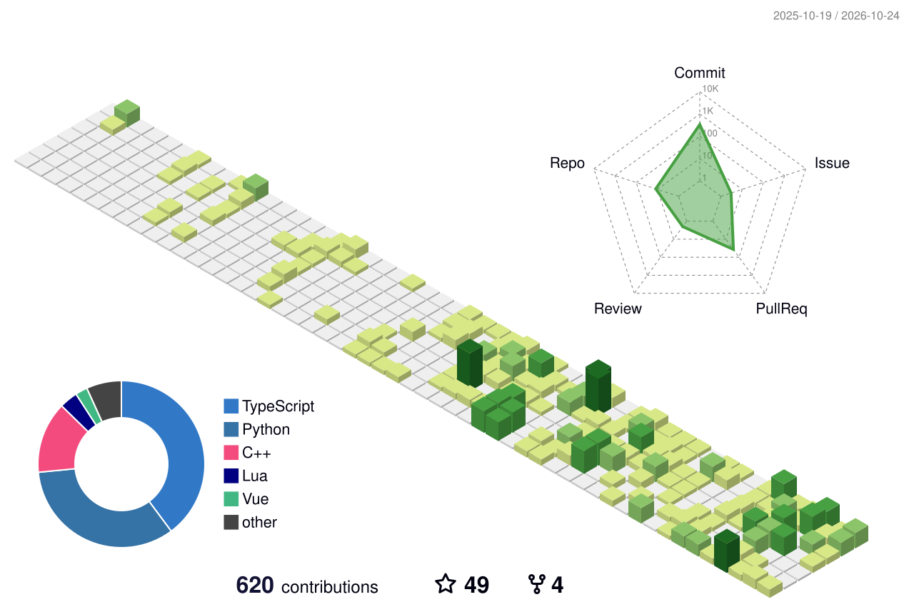

<!--
GitHub Stats:
- 默认主要统计个人拥有的公开仓库
- 对其他仓库的贡献仅部分计入
-->
  <picture>
    <source media="(prefers-color-scheme: dark)" srcset="https://github-stats-extended.vercel.app/api?username=Apprentice-Geo&show_icons=true&hide_rank=true&hide_border=true&card_width=440&theme=github_dark&title_color=3fb950&icon_color=3fb950">
    <source media="(prefers-color-scheme: light)" srcset="https://github-stats-extended.vercel.app/api?username=Apprentice-Geo&show_icons=true&hide_rank=true&hide_border=true&card_width=440&theme=default&title_color=2ea043&icon_color=2ea043">
    
  </picture>
<!--
Top Languages:
- 默认统计个人拥有的公开、非 Fork 仓库
-->
  <picture>
    <source media="(prefers-color-scheme: dark)" srcset="https://github-stats-extended.vercel.app/api/top-langs?username=Apprentice-Geo&layout=compact&langs_count=8&hide_border=true&card_width=340&theme=github_dark&title_color=3fb950">
    <source media="(prefers-color-scheme: light)" srcset="https://github-stats-extended.vercel.app/api/top-langs?username=Apprentice-Geo&layout=compact&langs_count=8&hide_border=true&card_width=340&theme=default&title_color=2ea043">
    
  </picture>

---

<!--
3D Contribution Calendar:
- 基于 GitHub Contributions 数据
- 包含符合条件的公开及匿名私人贡献
- 可包含对其他仓库的有效贡献
-->
  <picture>
    <source media="(prefers-color-scheme: dark)" srcset="./profile-3d-contrib/profile-night-green.svg">
    <source media="(prefers-color-scheme: light)" srcset="./profile-3d-contrib/profile-green.svg">
    
  </picture>

